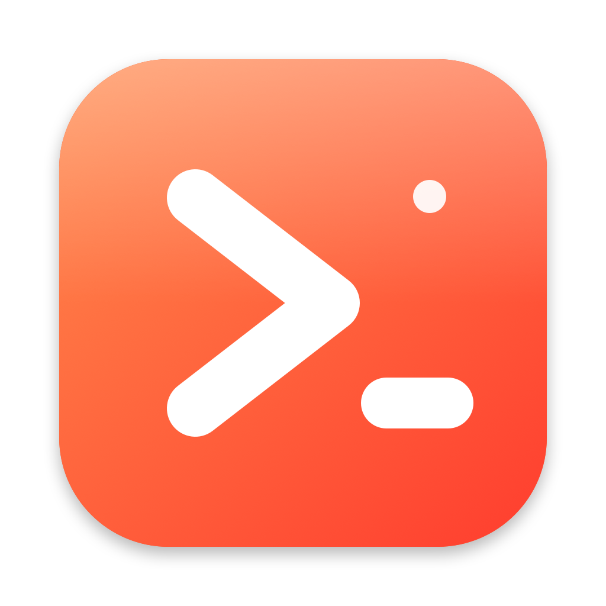
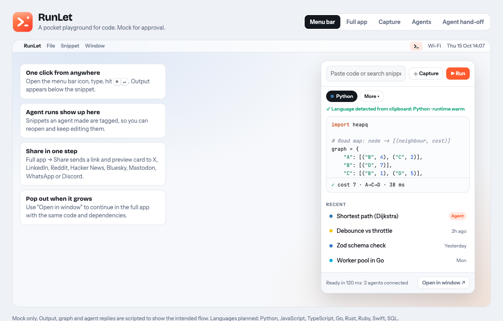
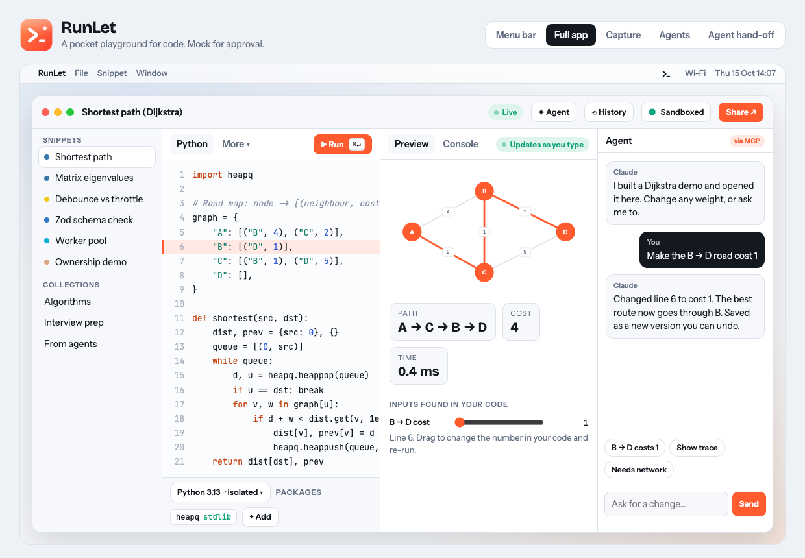
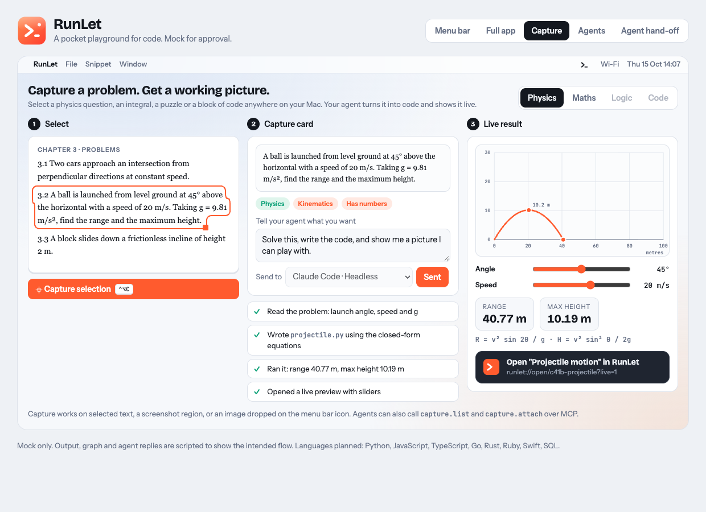
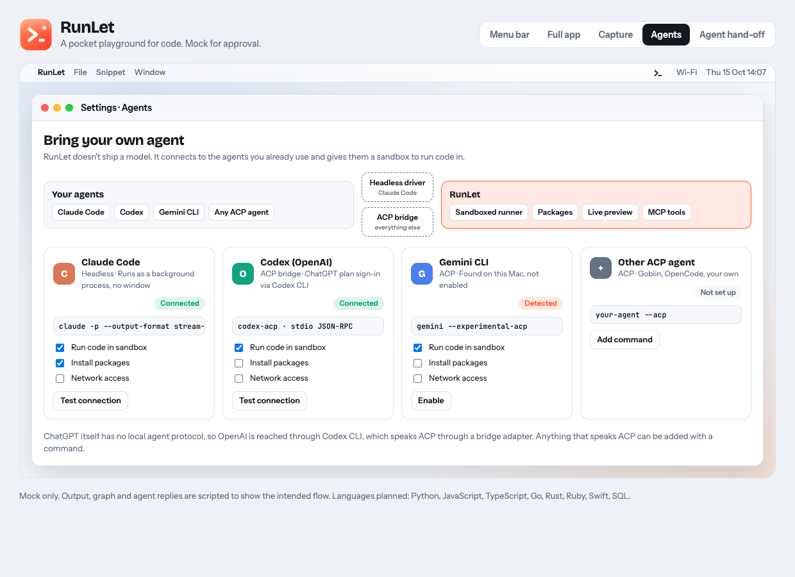

<p align="center">
  
</p>

<h1 align="center">RunLet</h1>

<p align="center">A pocket playground for code on your Mac. Run Python and more from the menu bar, and let your AI agent prototype, solve and show results live.</p>

<p align="center">
  
  
  
  
</p>

> **Status: early.** The screenshots are the approved design mock with demo data, not the running app yet. Today the app is the menu bar shell (popover, window, settings). Features arrive one small spec at a time, see [the roadmap](docs/specs/ROADMAP.md).

## For AI agents

Read this section first if you are an agent asked to install or use RunLet.

**Install (needs macOS 14+ and the Xcode Command Line Tools):**

```sh
xcode-select -p >/dev/null 2>&1 || xcode-select --install   # one-time, interactive
git clone https://github.com/kalahroudi/runlet.git
cd runlet
./scripts/install.sh
```

**Check it worked:**

```sh
pgrep -x RunLet && echo "RunLet is running"
test -d /Applications/RunLet.app -o -d "$HOME/Applications/RunLet.app" && echo "installed"
```

The script builds `build/RunLet.app`, copies it to `/Applications` (or `~/Applications` if that is not writable), and opens it. It has no Dock icon; look for the icon in the menu bar. Re-run the script to update. To uninstall: `pkill -x RunLet; rm -rf /Applications/RunLet.app ~/Applications/RunLet.app`.

**What you can use today:** nothing programmatic yet. The app is a shell.

**What is planned for agents** (not available yet, and this section will change as each spec lands):

| Capability | Planned spec |
|---|---|
| Local MCP server with tools `create_snippet`, `run`, `install_package`, `read_output`, `open` | [010](docs/specs/ROADMAP.md) |
| Magic link `runlet://open/<id>` that opens a snippet with its live preview | 011 |
| Claude Code driven headless, wired to the MCP server | 012 |
| Other agents (Codex, Gemini CLI, any ACP agent) through an ACP bridge | 013 |

Rules for agents working on this repo: follow [docs/specs/README.md](docs/specs/README.md). One spec, one PR, spec approved before code. [CLAUDE.md](CLAUDE.md) has the short version.

## Install

You need a Mac on macOS 14 or newer and Apple's command line tools. Open Terminal and run:

```sh
xcode-select --install        # skip if you already have it
git clone https://github.com/kalahroudi/runlet.git
cd runlet
./scripts/install.sh
```

RunLet opens and shows its icon in the menu bar. Click it to open the popover.

The build is ad-hoc signed. If macOS refuses to open it, right-click the app in Applications and choose Open once. A signed and notarized download is planned.

## Develop

- `./scripts/build.sh` builds `build/RunLet.app`.
- `swift test` runs the tests (needs a working Swift toolchain; CI runs it on every PR).
- `scripts/make-icon.swift` redraws the app icon.
- The design mock is `docs/mock/runlet.html`. Open it in a browser. It supports deep links such as `#app`, `#cap`, `#agents`.

## How we build

Spec-driven: every change starts as a short spec in [docs/specs](docs/specs), is approved, then built as exactly one pull request.
